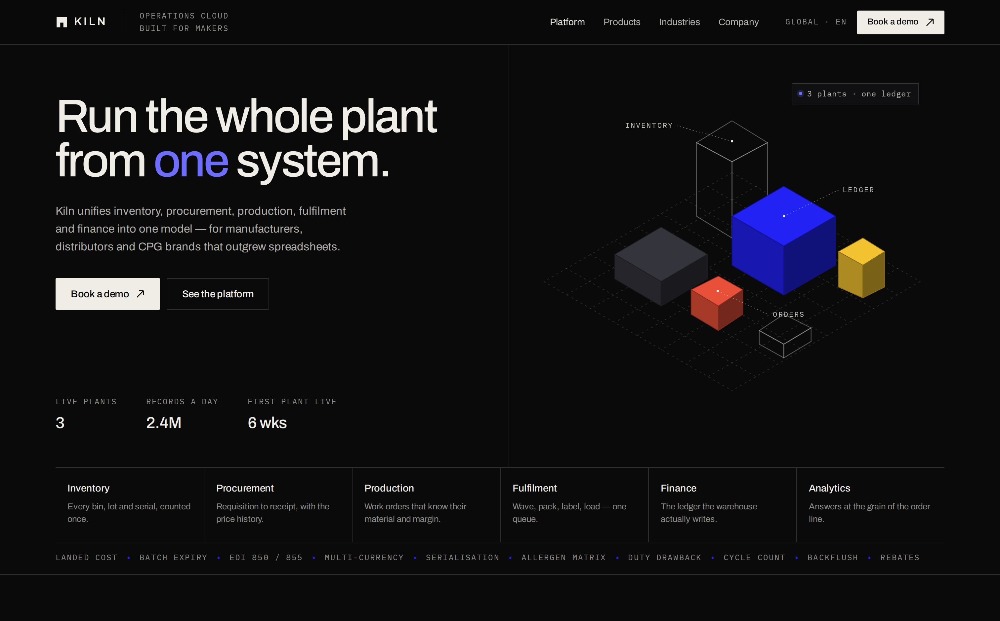
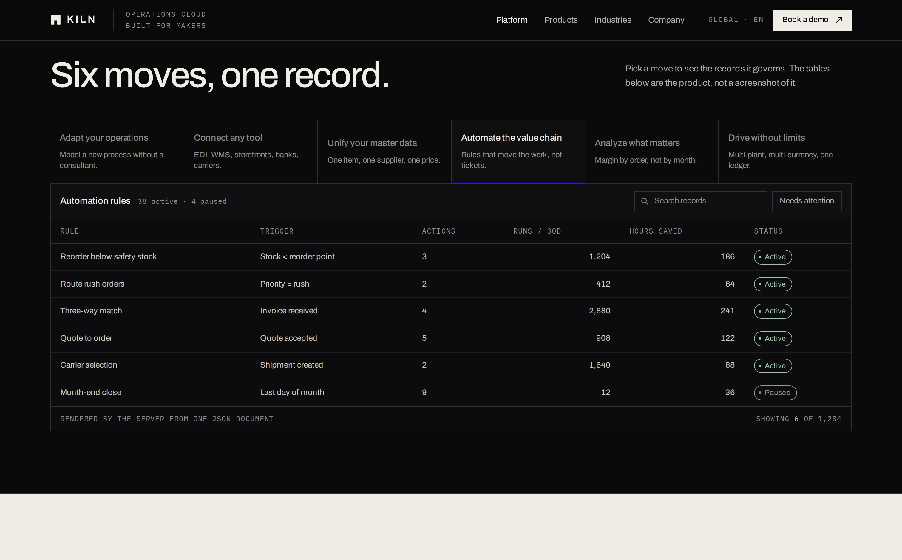
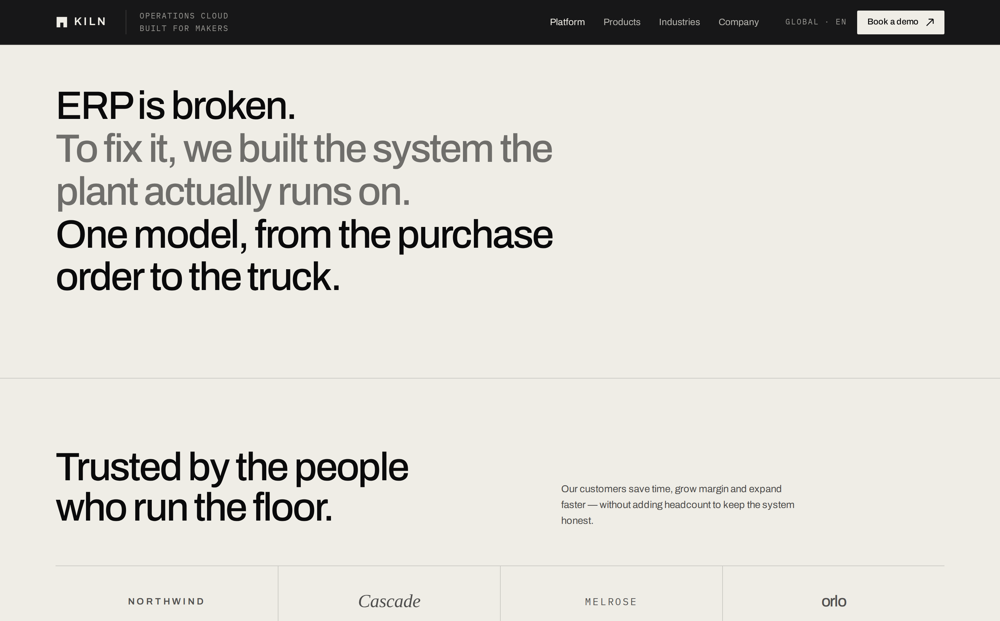
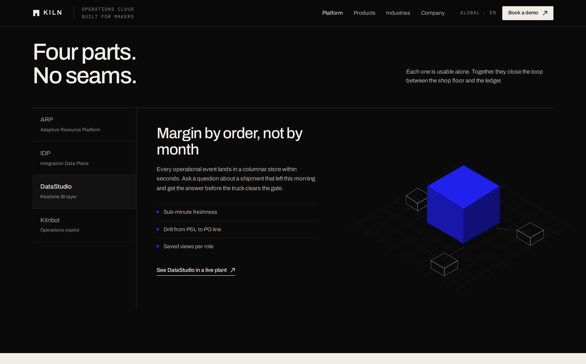
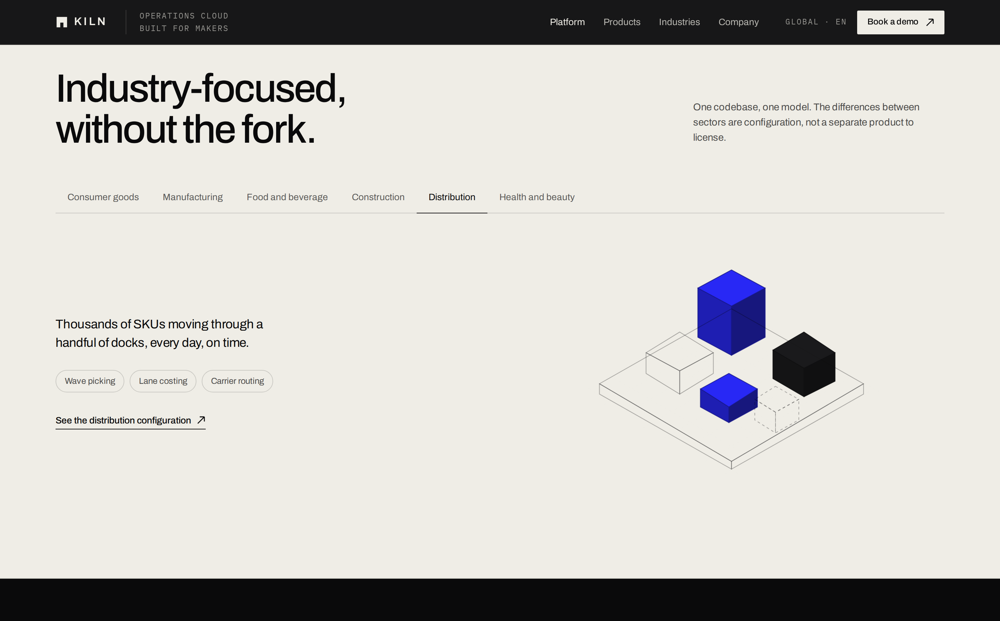
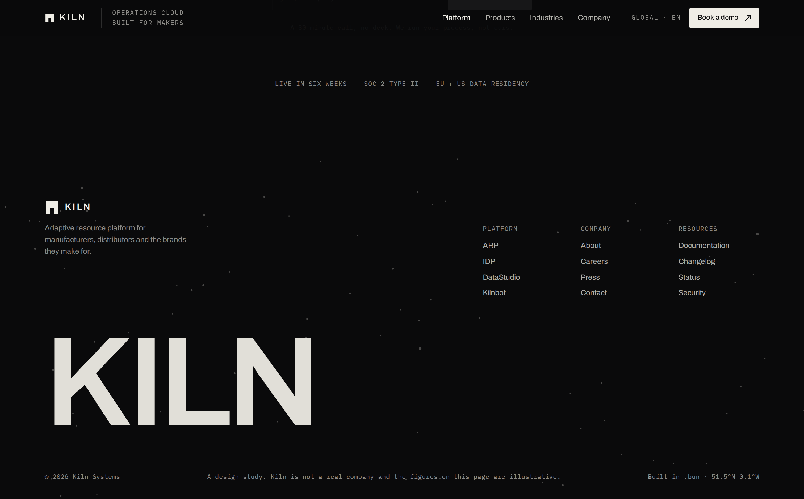
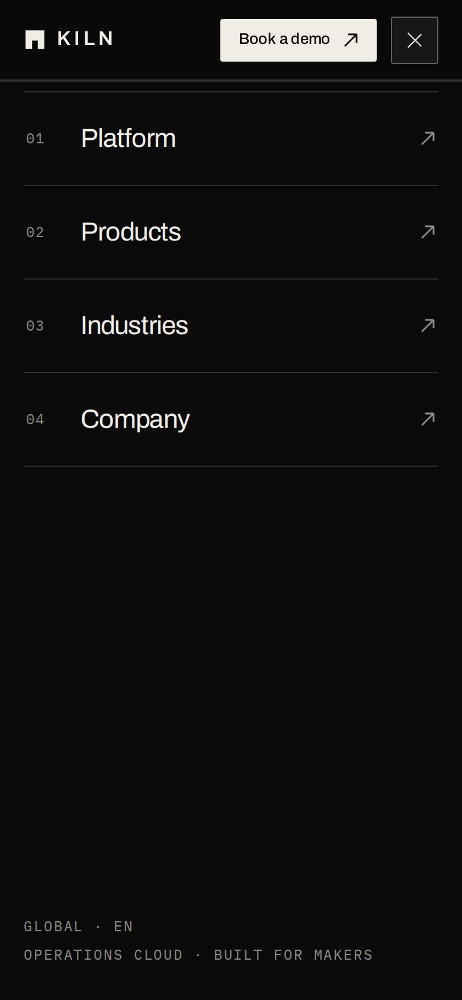

# Kiln

A marketing site for a fictional operations platform, written in the **Bun language** — the
small dynamically-typed language from [Iotatg/Bun](https://github.com/Iotatg/Bun), not the
JavaScript runtime. Every byte of HTML is produced by `.bun` files; there is no framework, no
build step, and no bundler. The server is a raw-socket HTTP/1.1 implementation in 414 lines of
Bun.

The design language is a study of
[Zajno's DOSS shot on Dribbble](https://dribbble.com/shots/27286980-Web-Design-for-an-Enterprise-ERP-Platform):
off-black and warm paper, hairline rules, mono HUD labels, one electric blue, and isometric
box diagrams standing in for product screenshots. All artwork on the page is generated
geometry — no photographs, no stock icons, no copied assets.



---

## Run it

```sh
# 1. the language runtime (a Python package, despite the name)
git clone https://github.com/Iotatg/Bun
export BUN_LANG_HOME="$PWD/Bun/bun"

# 2. the site
cd kiln-erp
PORT=8790 ./bin/kiln app.bun
```

Then open <http://localhost:8790>. `bin/kiln` is a four-line wrapper that puts the runtime on
`PYTHONPATH` and runs `python3 -m bun`. If you vendor the runtime into `./vendor/bun`, the
wrapper finds it without any environment variable.

```sh
./bin/kiln check app.bun      # parse-only syntax check
./bin/kiln fmt src/iso.bun    # the language's own formatter
sh scripts/smoke.sh           # 19 assertions, starts its own server on :8791
sh scripts/tunnel.sh          # public https URL through a Cloudflare quick tunnel
```

Requirements: Python 3.9+, and nothing else. No `pip install`, no `node_modules`.

## Routes

| Method | Path        | Answer                                                        |
| ------ | ----------- | ------------------------------------------------------------- |
| GET    | `/`         | the whole page, server-rendered                                |
| GET    | `/health`   | `{"ok":true,"service":"kiln"}`                                 |
| POST   | `/api/demo` | validates an email, appends to `data/leads.jsonl`, answers JSON |
| GET    | `/api/demo` | `405` with an `Allow` header                                   |
| GET    | `/assets/*` | CSS, JS, SVG, from disk, with a real `Content-Type`            |
| *      | anything    | `404`                                                          |

The form endpoint is not a stub: a bad address is refused with the reason, a good one is
appended to a JSONL file on disk, and the browser gets a sentence it can show. That is the
minimum for a form to be honest.

## Structure

```
app.bun              116 lines   entry point, routing, the form endpoint
src/http.bun         414 lines   raw-socket HTTP/1.1: keep-alive, chunked, MIME
src/iso.bun          311 lines   the isometric engine (projection, shading, painter sort)
src/content.bun      288 lines   every string and every table row on the page
src/page.bun         156 lines   document shell, fixed header, menu sheet, footer
src/sections.bun     504 lines   the nine sections, assembled from content.bun
assets/app.css      1252 lines   the design system
assets/app.js        256 lines   tabs, search, filters, the form, the menu, reveal
scripts/smoke.sh      96 lines   19 end-to-end assertions
scripts/tunnel.sh                 public URL, no account needed
scripts/iso-preview.bun           renders a sample scene to /tmp/iso.svg
```

The split matters: **content never lives in markup**. `content.bun` returns lists of dicts and
`sections.bun` renders them. Changing a table row is a one-line edit in one file, and the six
capability tabs, six datasets, four products and six industries all stay in sync because they
are the same data.

## The isometric engine

`iso.bun` turns a list of boxes into one `<svg>`:

```bun
iso_scene([
    { "x": 0, "y": 0, "z": 0, "w": 3, "d": 3, "h": 1.4, "fill": "#2222f5", "edge": "#7a7aff" },
    { "x": 4, "y": 0, "z": 0, "w": 1, "d": 1, "h": 1, "tone": "wire" }
], { "w": 680, "h": 500, "scale": 46, "grid": true, "callouts": [...] })
```

- 30° projection: `sx = (x − y)·cos30`, `sy = (x + y)·sin30 − z`
- three visible faces per box (top, left, right), each shaded from one fill colour by a factor
  derived from a light direction, so a single hex is enough to describe a solid
- painter's algorithm: boxes sorted by `x + y + z` so nearer solids cover further ones
- `vector-effect="non-scaling-stroke"` on every path, so hairlines stay hairlines when the
  group is scaled down on a phone
- callout labels are drawn **outside** the scaled group, in screen space, so 12px type stays
  12px no matter the viewport

Four diagram types are built on it (`stack`, `links`, `orbit`, `core`), plus the hero scene,
each with its own palette pulled from the brand tones.

## Design system

Tokens, the type ramp, and the rules are in [DESIGN.md](DESIGN.md). Short version:

| Token         | Value     | Use                                  |
| ------------- | --------- | ------------------------------------ |
| `--ink`       | `#0a0a0b` | page ground, dark bands              |
| `--paper`     | `#efede6` | warm light bands, footer wordmark    |
| `--blue`      | `#2222f5` | the one accent: solids, focus, links |
| `--blue-text` | `#6d6dff` | the same blue, legible on ink        |
| `--yellow`    | `#f2c230` | one box per diagram, never type      |
| `--red`       | `#e8503a` | alert status only                    |

Type: **Archivo** for display and text, **IBM Plex Mono** for every label, number and
standing datum. The display face is not a system font, and no label on the page is smaller
than 12px.

## Verified

- `scripts/smoke.sh` — **19 passed, 0 failed** (routes, MIME types, byte-accurate
  `Content-Length`, form validation, 404, 405).
- **impeccable detect** — **0 anti-patterns**, 9 advisory notes, all of them the isometric
  diagrams flagged as "assembled illustrations". That is the intended medium: the reference
  design uses exactly this kind of drawn diagram instead of screenshots.
- Playwright, 12 viewports from 320px to 1920px: `scrollWidth − clientWidth = 0` everywhere.
- Playwright, interaction: tabs swap datasets, search narrows to one row and shows an empty
  state, the alert filter yields two rows, the product rail and industry tabs swap panes, the
  form returns its success sentence, the menu sheet opens, locks the page, closes on Escape
  and on navigation. Zero console errors.

## Screenshots

| | |
|---|---|
|  |  |
|  |  |
|  |  |

## Honest notes

- **Kiln is not a real company.** The copy, the customers, the statistics and the tables are
  written for this study. The footer says so on the page.
- The logos in the trust band are set in type, not drawn marks, because inventing four
  convincing logos would have meant four more illustration problems.
- `data/leads.jsonl` is a file, not a database. It is in `.gitignore`.
- The page ships one stylesheet and one script, both unminified, because at this size a build
  step would cost more than it saves.

## Licence

The code is MIT. The design is a study of a public Dribbble shot by Zajno; no assets were
copied, only the visual grammar was read.
